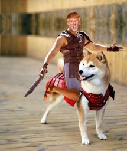

# Fake-news-classification

Final project for the UC Berkeley IEOR's Spring 2026 offering of IND ENG 142B.
This project was created by Alex Chen, Derrick Chun, Yash Saxena, Ziara Vasquez, and Christian Warburg

# Multimodal Fake News Classification with a Deep Learning Model

Multimodal binary classifier (real vs. fake) on the [Fakeddit](https://github.com/entitize/Fakeddit) dataset. Each sample is a Reddit post with a short title and an image; the model fuses both modalities and predicts the 2-way label.

# Abstract

This project studies multimodal fake news classification using paired text and images from
the Fakeddit dataset. We formulate the problem as a binary classification task, where each
example consists of a headline-image pair and the model predicts whether the pair corresponds
to real or misleading content. Our model combines contextual text representations from a fine-
tuned BERT encoder with visual representations from a pretrained DINOv2 Vision Transformer
image encoder, then fuses both modalities through a multilayer classifier. On the held-out test
set, the final model achieves 85.0% accuracy, 0.914 AUC-ROC, and 0.842 F1 score. Although
these results suggest that multimodal representations can learn useful signals from image-text
pairs, there is still substantial label noise, class imbalance, false-positive risks, and possible bias
in the underlying data.


## Method

### Data
- Source: `multimodal_only_samples/multimodal_{train,validate,test_public}.tsv` (Fakeddit v2 multimodal split).
- `download_images.py` fetches each post's image from `image_url` into `images/{split}/{id}.{ext}`, then writes a manifest CSV with the rows whose images downloaded successfully.
- `make_split.py` carves out a stratified 80/20 sample for experiments.
- Final manifests used for training: `manifests/train.csv` (8,088 rows) and `manifests/test.csv` (1,914 rows). Columns: `id, image_path, clean_title, label_2way, label_3way, label_6way`.
- Label convention (`label_2way`): **0 = fake**, **1 = real**. Class balance in our train split is roughly 71 % fake / 29 % real.

### Examples

Each row is a `(title, image)` pair; the model has to use both to predict the label.

| id | title | image | label |
|---|---|---|---|
| `dif4mex` | "this is murica" |  | fake |
| `caekgj2` | "has science gone too far" |  | fake |
| `cq0bn0g` | "biff no youll break his arm" |  | fake |
| `c05xpc` | "this very nondescript restaurant sign" |  | real |
| `c3ymn3` | "the hair dye boxes in korean supermarket featuring dolls" |  | real |
| `c1hlbb` | "venice italy" |  | real |

### Model (`train.py`)
Late-fusion architecture with two modality-specific encoders:

```
title  --> BERT (bert-base-uncased) --> [CLS] --> Linear --+
                                                           +--> concat --> MLP --> softmax(2)
image  --> CNN (4 conv blocks + GAP) -----------> Linear --+
```

- **Text encoder**: `bert-base-uncased` from HuggingFace, fine-tuned end-to-end. The `[CLS]` hidden state is projected to a `fusion_dim`-sized embedding.
- **Image encoder**: a from-scratch CNN — four `Conv -> BatchNorm -> ReLU -> MaxPool` blocks (32 -> 64 -> 128 -> 256 channels), global average pool, projected to `fusion_dim`.
- **Fusion / head**: concatenate the two embeddings and pass through a 2-layer MLP with dropout to produce the 2-way logits.
- **Loss**: cross-entropy on `label_2way`.

### Training
- Optimizer: AdamW with two parameter groups — `lr_bert=2e-5` for the BERT backbone, `lr_other=1e-3` for the CNN, projections, and head.
- Schedule: linear warmup (10 % of steps) then linear decay; gradient clipping at 1.0.
- Image augmentation on train only: resize -> random horizontal flip -> small color jitter -> ImageNet-normalize.
- Defaults: 5 epochs, batch size 32, 128x128 images, max title length 64 tokens.

### Logging (Weights & Biases)
Every run logs config, per-step train loss / accuracy / learning-rates, per-epoch train + test loss / accuracy / macro-F1 / macro-precision / macro-recall / AUC, a confusion matrix, and gradient histograms via `wandb.watch`. The best test-accuracy checkpoint is saved to `runs/best.pt`.

## Repository layout
```
download_images.py    # fetch Fakeddit images, write manifests/{split}.csv
make_split.py         # stratified train/test resample of a manifest
train.py              # multimodal model + training loop + wandb logging
train.sh              # LSF jobscript for DTU HPC (gpuv100)
manifests/            # train/test CSVs (text + label + image path)
```
Not committed: `images/`, `multimodal_only_samples/`, `runs/`, `wandb/` (see `.gitignore`).

## Running

### Build the data
```sh
python download_images.py --split train
python download_images.py --split test
```

### Interactive smoke test on a GPU node (DTU HPC)
```sh
voltash                              # or: bsub -Is -q gpuv100 -gpu "num=1:mode=exclusive_process" ...
source "$(conda info --base)/etc/profile.d/conda.sh" && conda activate base
module load cuda/11.8
cd /work3/s225083/indeng242/fake_news
pip install --user "transformers>=4.40" "huggingface_hub>=0.23"
wandb login
python train.py --epochs 1 --wandb_run_name interactive
```

### Submit the full job
```sh
bsub < train.sh
```

Key flags: `--epochs`, `--batch_size`, `--max_len`, `--image_size`, `--lr_bert`, `--lr_other`, `--wandb_mode {online,offline,disabled}`. See `train.py --help` for the full list.
